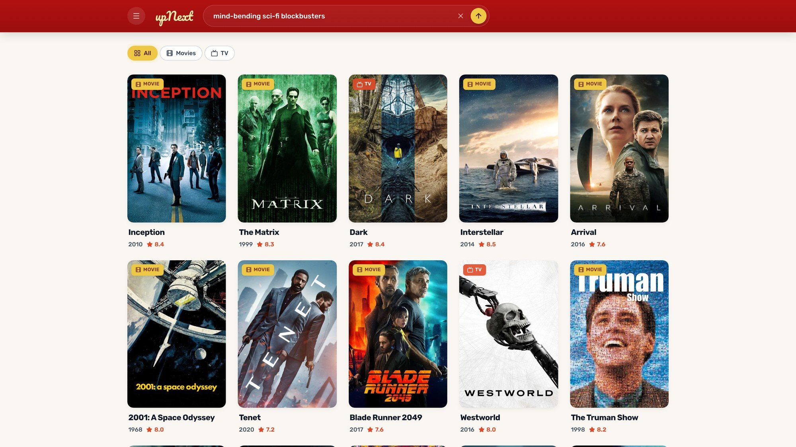

# Up Next

Describe a vibe ("that 3am can't-sleep melancholy", "like Severance but funnier") and get movie and TV picks, each with a one-line reason it fits.

**Live:** [upnext-app-production.up.railway.app](https://upnext-app-production.up.railway.app)



## Built with

- **Frontend:** React 18, Vite, Tailwind CSS, Framer Motion, shadcn/Radix
- **Backend:** Node.js, Express, OpenAI SDK (structured outputs), TMDB API
- **Analytics:** PostHog
- **Deploy:** Railway (Express serves the built frontend)

## Features

- **Natural-language search:** moods, plots, people, eras, comparisons, typos and other languages
- **"Why it's a match":** every pick comes with a specific, model-written reason
- **More Like This and @mentions:** type `@title` or tap More Like This for similar titles
- **Rich details:** posters, synopsis, cast, director, US streaming providers and trailers
- **Filters and discovery:** movie/TV filters, Surprise Me, curated vibe categories
- **Cmd+K command palette** with keyboard navigation
- **Responsive:** a drawer on desktop, a bottom sheet on mobile, light and dark themes

## How it works

```
query ──► LLM (structured JSON: title, year, kind, reason)
            │  up to 20 picks, ranked by fit
            ▼
        TMDB search ──► match each pick by title and year
            ▼
        TMDB details ──► genres, cast, director, certification, runtime, providers
            ▼
        filter ──► dedupe ──► interleave movies and TV ──► cache for 30 min
```

A typical search takes 7 to 10 seconds: 6 to 9 for the model and about 1 for TMDB, which looks up every pick in parallel. Repeat searches return from the cache.

## How I built it

The first version was a vector search engine. I loaded about 60,000 titles into Supabase with pgvector, gave each one three embeddings (content, vibe and metadata), and ranked results with LLM-weighted similarity across the three plus a custom reranker.

It worked, but most of my time went into the retrieval layer: tuning candidate counts, fighting statement timeouts, and keeping the catalogue fresh. For the second version I retired the database. The model now picks the titles directly as structured JSON, and TMDB supplies all the title data live. The UI and the API shape stayed the same, so the swap was invisible to users.

## What I learned

- How vector search works in practice: embeddings, pgvector indexes, and why one embedding per title was not enough to capture "vibe".
- When to delete a system. The vector database was the most interesting part of the project and also the part costing the most to keep running.
- Structured outputs make an LLM usable as a backend component. The server validates a fixed JSON shape and never parses free text.
- Never trust the model for facts. It suggests titles; every poster, cast list and streaming provider comes from TMDB.

## What I'd improve

- Stream picks to the UI as they arrive, so the 7 to 10 second wait feels shorter.
- Streaming providers outside the US.
- Automated tests around the title-matching step.

## Run it locally

```bash
npm install
cp .env.example .env   # add OPENAI_API_KEY and TMDB_TOKEN
npm run dev            # frontend on :3001, backend on :5001
```

Get a TMDB "API Read Access Token" at [themoviedb.org/settings/api](https://www.themoviedb.org/settings/api).

<details>
<summary>Environment variables</summary>

| Variable | Description | Default |
| --- | --- | --- |
| `OPENAI_API_KEY` | OpenAI API key | required |
| `TMDB_TOKEN` | TMDB API Read Access Token | required |
| `OPENAI_MODEL` | Model that picks titles | `gpt-6-luna` |
| `REASONING_EFFORT` | `none` / `low` / `medium` / `high` / `xhigh` | `low` |
| `OPENAI_SERVICE_TIER` | `priority` or `default` | `priority` |
| `SEARCH_CACHE_TTL_MINUTES` | In-memory result cache TTL | `30` |
| `PORT` | Backend port | `5001` |

</details>

<details>
<summary>API</summary>

| Endpoint | Description |
| --- | --- |
| `POST /api/search` | `{ query, kindFilter?, minReleaseYear?, excludeGenres? }` → `{ query, model, results, count }` |
| `POST /api/similar` | `{ titleId, kind, kindFilter?, ... }` → titles similar to a TMDB title |
| `GET /api/titles/search?q=` | Title autocomplete for `@mentions` |
| `GET /api/trailer/:tmdbId?mediaType=` | YouTube trailer from TMDB |
| `GET /api/recommendations` | Trending titles |
| `GET /api/health` | Status and active model |

```bash
curl -X POST http://localhost:5001/api/search \
  -H "Content-Type: application/json" \
  -d '{"query":"slow burn sci-fi with big ideas","kindFilter":["movie"]}'
```

</details>

## Credits

Movie and TV metadata and images come from [TMDB](https://www.themoviedb.org/). This product uses the TMDB API but is not endorsed or certified by TMDB.
